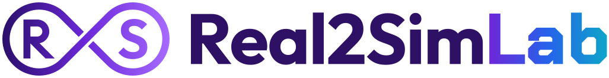
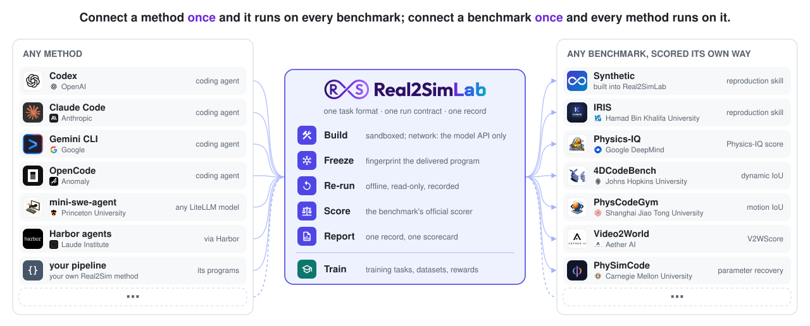

<div align="center">

<picture>
  <source media="(prefers-color-scheme: dark)" srcset="docs/assets/logo-dark.svg">
  
</picture>

<h3>A unified platform for real-to-simulation</h3>

<p><b>Any method, any benchmark: true to each, together on one scorecard.</b></p>

<p>
📄 <a href="https://arxiv.org/abs/2611.34849"><b>Paper</b></a> &nbsp;·&nbsp;
📖 <a href="https://real2simhub.github.io/Real2SimLab/"><b>Documentation</b></a> &nbsp;·&nbsp;
🚀 <a href="docs/quickstart.md"><b>Quickstart</b></a> &nbsp;·&nbsp;
📊 <a href="docs/benchmarks/index.md"><b>Benchmarks</b></a> &nbsp;·&nbsp;
🧪 <a href="docs/results.md"><b>Example run</b></a> &nbsp;·&nbsp;
🎯 <a href="docs/guides/evaluation.md"><b>Evaluation</b></a> &nbsp;·&nbsp;
🏋️ <a href="docs/guides/training.md"><b>Training</b></a> &nbsp;·&nbsp;
📐 <a href="docs/spec/index.md"><b>Specification</b></a> &nbsp;·&nbsp;
🌏 <a href="README_zh.md"><b>中文</b></a>
</p>

[](https://arxiv.org/abs/2611.34849)
[](https://github.com/Real2SimHub/Real2SimLab/actions/workflows/ci.yml)
[](https://real2simhub.github.io/Real2SimLab/)
[](pyproject.toml)
[](LICENSE)
[](docs/spec/index.md)
[](docs/concepts.md)
[](docs/quickstart.md)
[](https://real2simhub.github.io/assets/img/connect/wechat-group.jpg)

<!-- The Real2SimHub series: the hub, this repository and the research map. -->
<table align="center">
  <tr>
    <td align="center"><a href="https://real2simhub.github.io/"><picture><source media="(prefers-color-scheme: dark)" srcset="docs/assets/symbol-hub-dark.svg"></picture> <b>Real2SimHub</b></a></td>
    <td align="center"><a href="https://github.com/Real2SimHub/Real2SimLab"><picture><source media="(prefers-color-scheme: dark)" srcset="docs/assets/symbol-lab-dark.svg"></picture> <b>Real2SimLab</b></a></td>
    <td align="center"><a href="https://github.com/Real2SimHub/Awesome-Real2Sim"><picture><source media="(prefers-color-scheme: dark)" srcset="docs/assets/symbol-awesome-dark.svg"></picture> <b>Awesome&#8209;Real2Sim</b></a></td>
  </tr>
</table>

</div>

<picture>
  <source media="(prefers-color-scheme: dark)" srcset="docs/assets/teaser-dark.svg">
  
</picture>

Real-to-simulation benchmarks ask a model to turn a recording of a physical event into a
simulation program that reproduces it. Physics-IQ, Video2World, 4DCodeBench, PhysCodeGym,
PhySimCode and others each come with their own data layout, delivery format, agent setup and
scorer. Evaluating one agent on all of them means one integration per pair, and results that are
hard to compare or reproduce.
**Real2SimLab connects each agent and each benchmark once.** It runs every method the same way
(sandboxed, network-limited, recorded), freezes what it delivers, re-runs it offline, and scores
it with the benchmark's own official scorer, so results from every benchmark land in one record
format and one scorecard. The same task format and scorer serve training: the Lab generates
training tasks with exact truth or takes your own, exports them and the runs on them as datasets
checked against the evaluation tasks, trains methods that learn, and scores any program as a
reward, exactly as an evaluation would.

## ✨ Highlights

- 🎯 **Six benchmarks, each scored its own way.** Official scorers run from pinned checkouts and
  are checked against the originals: on Physics-IQ the Lab's numbers match the official pipeline
  to the last digit. A raw dataset (IRIS) and our own synthetic suite with exact truth get the
  Lab's reproduction metrics; where an event was recorded again (IRIS), the repeats give the
  noise floor.
- 🤖 **Any agent, the same way.** 47 coding agents: every agent of
  [Harbor](https://harborframework.com) (47 in Harbor 0.27: OpenHands, Aider, Cursor CLI, Goose,
  Qwen Code...), five of them (Codex, Claude Code, Gemini CLI, OpenCode, mini-swe-agent) also
  directly; or your own pipeline's programs. Agents run in a
  sandbox whose network reaches only the model API; keys never reach runs, logs or images.
  Codex, mini-swe-agent and Harbor's agents work in an image with the task's runtime (Blender,
  ManiSkill, Matplotlib...); Claude Code, Gemini CLI and OpenCode in their own Python image for
  those tasks.
- 🧊 **Frozen, offline re-runs.** What is scored is the delivered program re-run offline and
  read-only, not what the agent showed in its session; the Lab checks that both agree.
- 📋 **One record, one scorecard.** Every result carries its benchmark's headline metric with its
  reference points (a static scene, a second recording, the benchmark's reference solution);
  the scorecard combines tasks the way each benchmark does, with bootstrap intervals.
- 🏋️ **Training data and rewards from the same code.** Generated training tasks with exact
  truth, or any dataset you convert; datasets of inputs, labels, delivered programs, rewards and
  redacted agent trajectories, with every task that holds an evaluation recording left out; any
  program's reward is its evaluation score. A
  [worked example](docs/guides/training.md#example-a-method-that-learns) trains a small method
  on them and evaluates it on the benchmark, skipping every task that overlaps its training
  data.
- 🧩 **Built to be extended.** A frozen [specification](docs/spec/index.md) with JSON Schemas,
  plugins for benchmarks, methods, metrics and backends, and [agent skills](AGENTS.md#skills)
  that walk your coding agent through integrating a new benchmark.
- 🗺️ **A survey of the field.** [Awesome-Real2Sim](https://github.com/Real2SimHub/Awesome-Real2Sim), released with the Lab, is a curated
  survey of real-to-simulation research: methods, benchmarks, datasets and surveys, each placed
  by what it delivers and tagged with how it is built, the physics it covers and how it is
  evaluated.

## 🚀 Quickstart

```bash
git clone https://github.com/Real2SimHub/Real2SimLab.git && cd Real2SimLab
pip install -e .        # Python 3.11+ and ffmpeg
r2s demo --open         # scores baselines and two scripted agents on two tasks: about 30 s on a CPU
```

The demo runs its twins in Docker when it is there, in bubblewrap on Linux without root, and
otherwise unisolated with a warning. Evaluations and the other commands that run twins use
Docker unless given another backend: without Docker, unpack the runtime image and pass
`--backend bwrap` ([Run on a cluster without Docker](docs/tutorials/clusters.md)).
`r2s doctor` lists what is missing and how to fix it.

## 🤖 Evaluate your agent

```bash
r2s bench list                                         # the benchmarks: status, protocols, splits, license
r2s run examples/experiments/unified.toml              # Codex on all of them, one scorecard
r2s eval --benchmark synthetic --method claude_code --out runs/claude   # or one at a time
```

| &nbsp;&nbsp;&nbsp;&nbsp;&nbsp;&nbsp; | Agent | `--method` | How it runs |
|:-:|---|---|---|
|  | Codex&nbsp;CLI | `codex` | `codex exec` in the sandbox; your Codex login or `OPENAI_API_KEY` |
|  | Claude&nbsp;Code | `claude_code` | `claude -p` in the sandbox; image built locally (Claude Code is proprietary) |
|  | Gemini&nbsp;CLI | `gemini_cli` | in the sandbox; `GEMINI_API_KEY` or `GOOGLE_API_KEY` |
|  | OpenCode | `opencode` | `opencode run` in the sandbox, any provider it supports (experimental) |
|  | mini&#8209;swe&#8209;agent | `mini_swe` | the agent loop on the host with any LiteLLM model; every command in the sandbox |
|  | Harbor&nbsp;agents | `harbor` | any of the 47 agents [Harbor](https://harborframework.com) 0.27 supports (`agent=openhands`, `aider`, `cursor-cli`, ...) |
|  | your&nbsp;pipeline | `program` | its programs, written with the [twin SDK](docs/tutorials/write-twin.md) |

Codex, mini-swe-agent and Harbor's agents work in an image with the task's runtime; Claude Code,
Gemini CLI and OpenCode work in their own Python image on Blender, PhySimCode and Video2World
tasks (`image=` names another). Credentials, budgets and network rules:
[Evaluate an agent](docs/tutorials/evaluate-agent.md). Choosing tasks, comparing methods
and reporting a score: [Evaluation](docs/guides/evaluation.md).

## 🏋️ Train

```bash
r2s train tasks --count 200 --tier calibrated --out train/tasks  # training tasks, exact truth
r2s bench build synthetic --tier calibrated --out eval/tasks     # the evaluation tasks
r2s train export --tasks train/tasks --against eval/tasks --out train/data   # a dataset
r2s train fit nearest_twin --data train/data --out train/model   # a method that learns
r2s eval --tasks eval/tasks --method nearest_twin:checkpoint=train/model --out eval/run
r2s train reward --task <task> --solution <program dir>           # a reward = its evaluation score
```

Training tasks are the synthetic phenomena with sampled hidden parameters and initial states,
labelled with their trajectories, parameters and truth program, or your own tasks marked
`split = "train"`. An export with `--against` leaves out every task that holds the same file
or the same recording as an evaluation task; evaluation tasks are not exported unless you ask,
and never those of a benchmark whose terms forbid it. An evaluation of a trained method skips
every task that overlaps one of its training tasks. Tasks with a `run.py` solution, training
tasks included, also export as Harbor tasks for Harbor's reinforcement-learning integrations.
The Lab ships no trainer and no weights: [Training](docs/guides/training.md).

## 📊 Benchmarks

Six benchmarks, plus a synthetic suite of our own. Every adapter runs the benchmark's own
protocol, and is checked against the original before it is trusted:

| &nbsp;&nbsp;&nbsp;&nbsp;&nbsp;&nbsp; | Benchmark | Scored by (headline metric) | Links |
|:-:|---|---|---|
|  | [**Physics-IQ**](docs/benchmarks/physics-iq.md)<br><sub>real&nbsp;physical&nbsp;events</sub> | official motion-mask metrics (Physics-IQ score) | [](https://arxiv.org/abs/2501.09038) [](https://github.com/google-deepmind/physics-IQ-benchmark) [](https://console.cloud.google.com/storage/browser/physics-iq-benchmark) |
|  | [**Video2World**](docs/benchmarks/video2world.md)<br><sub>robot&nbsp;and&nbsp;hand manipulation</sub> | official evaluator, executing the package (V2WScore: build × mean of functionality, geometry and dynamics) | [](https://arxiv.org/abs/2610.04432) [](https://github.com/AetherLabsAI/Video2World) [](https://huggingface.co/datasets/AetherLabs-AI/Video2World) |
|  | [**4DCodeBench**](docs/benchmarks/fourdcodebench.md)<br><sub>synthetic&nbsp;dynamic&nbsp;scenes</sub> | official scorer, in its own image (dynamic IoU) | [](https://arxiv.org/abs/2610.03715) [](https://github.com/4DCodeBench/4DCodeBench) [](https://huggingface.co/datasets/4DCodeBench/Dataset-Synthetic) |
|  | [**PhysCodeGym**](docs/benchmarks/physcodegym.md)<br><sub>real&nbsp;and&nbsp;generated</sub> | official pixel and motion metrics (motion IoU) | [](https://arxiv.org/abs/2610.17288) [](https://github.com/ShaoShuai0605/PhysCodeGym) [](https://huggingface.co/datasets/ShaoShuai0605/PhysCodeGym) |
|  | [**PhySimCode**](docs/benchmarks/physimcode.md)<br><sub>simulated&nbsp;2D&nbsp;physics</sub> | official parameter recovery (parameters within 20 %) | [](https://arxiv.org/abs/2610.15722) [](https://github.com/SourajaKundu/PhySimCode) [](https://huggingface.co/datasets/SourajaKundu123/PhySimCode) |
|  | [**IRIS**](docs/benchmarks/iris.md)<br><sub>real&nbsp;ball&nbsp;drops</sub> | Lab trajectory metrics (reproduction skill) | [](https://arxiv.org/abs/2603.16432) [](https://github.com/KurbanIntelligenceLab/iris-bench) [](https://huggingface.co/datasets/rasulkhanbayov/IRIS) |
|  | [**Synthetic**](docs/benchmarks/synthetic.md)<br><sub>5&nbsp;rendered&nbsp;phenomena</sub> | Lab trajectory metrics (reproduction skill) | built in |

Third-party code and data are fetched at a pinned revision when you build or score tasks, never
redistributed; each page gives the license, the details of the check and what is not covered
yet. How this relates to the benchmarks themselves and to Harbor: [Related work](docs/related.md).
[An example run](docs/results.md) shows what a full evaluation produces: one agent on every
benchmark, its records and its scorecard.

## 🧩 Extend it

- 🛠️ **Your Real2Sim pipeline:** write its output with the [twin SDK](docs/tutorials/write-twin.md)
  and evaluate it with `--method program`.
- 🎥 **Your recordings:** [write tasks](docs/tutorials/write-tasks.md) or
  [add a benchmark](docs/tutorials/add-benchmark.md).
- 🤝 **Your coding agent does it:** open it in this repository and ask it to use the
  `add-benchmark` skill on your benchmark; it checks the license, implements the benchmark's
  own protocol, validates against its reference solutions and adds tests and a page.

A benchmark built on the Lab can include it as a git submodule ([guide](docs/guides/build-on.md)).

## 📝 Citation

If you use Real2SimLab or Awesome-Real2Sim, please cite our paper:

```bibtex
@article{real2simlab2026,
  title   = {Real2SimLab: A Unified Platform for Real-to-Simulation Transfer},
  author  = {Zhang, Yongchang and Huang, Jie and Ni, Yunhe and Zhou, Ningyu and Zhao, Guangyu and Liu, Ruixun and Huang, Rui and Wu, Yidi and Zhang, TianZe and Jiang, Zixiang and Li, Xiang and Shen, Kevin and Zhong, Yiwu},
  journal = {arXiv preprint arXiv:2611.34849},
  year    = {2026}
}
```

## 🙏 Acknowledgements

Real2SimLab builds on XPolicyLab, Harbor, mini-SWE-agent, Blender, ManiSkill and SAPIEN, and on the official
code and data of Physics-IQ, Video2World, 4DCodeBench, PhysCodeGym, PhySimCode and IRIS. We thank the
authors and maintainers for their open-source contributions to the community.

## 📄 License

Apache-2.0. Third-party code and data are never bundled; see [NOTICE](NOTICE). Product names
and logos are trademarks of their owners and only identify the agents and benchmarks the Lab
runs; no endorsement is implied.

## 📬 Contact us

**Homepage:** [real2simhub.github.io](https://real2simhub.github.io/)

<table>
  <tr><th>WeChat group</th><th>WeChat</th></tr>
  <tr>
    <td></td>
    <td></td>
  </tr>
</table>

**Contact us by email:** [jayhuang303hh@gmail.com](mailto:jayhuang303hh@gmail.com)
