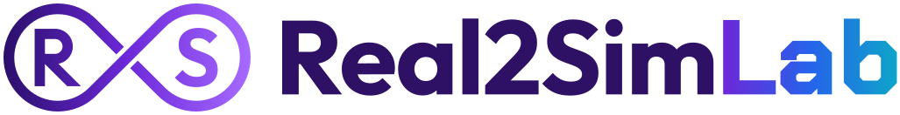
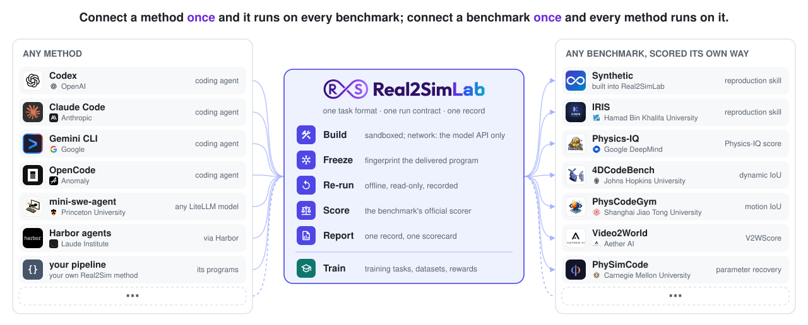
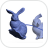

<div align="center">

<picture>
  <source media="(prefers-color-scheme: dark)" srcset="docs/assets/logo-dark.svg">
  
</picture>

<h3>Real-to-simulation（真实到仿真）的统一平台</h3>

<p><b>任何方法，任何 benchmark：忠于每一个，汇于一张成绩表。</b></p>

<p>
📄 <a href="https://arxiv.org/abs/2611.34849"><b>论文</b></a> &nbsp;·&nbsp;
📖 <a href="https://real2simhub.github.io/Real2SimLab/"><b>文档</b></a> &nbsp;·&nbsp;
🚀 <a href="docs/quickstart.md"><b>快速上手</b></a> &nbsp;·&nbsp;
📊 <a href="docs/benchmarks/index.md"><b>Benchmarks</b></a> &nbsp;·&nbsp;
🧪 <a href="docs/results.md"><b>示例运行</b></a> &nbsp;·&nbsp;
🎯 <a href="docs/guides/evaluation.md"><b>评测</b></a> &nbsp;·&nbsp;
🏋️ <a href="docs/guides/training.md"><b>训练</b></a> &nbsp;·&nbsp;
📐 <a href="docs/spec/index.md"><b>规格</b></a> &nbsp;·&nbsp;
🌏 <a href="README.md"><b>English</b></a>
</p>

[](https://arxiv.org/abs/2611.34849)
[](https://github.com/Real2SimHub/Real2SimLab/actions/workflows/ci.yml)
[](https://real2simhub.github.io/Real2SimLab/)
[](pyproject.toml)
[](LICENSE)
[](docs/spec/index.md)
[](docs/concepts.md)
[](docs/quickstart.md)
[](https://real2simhub.github.io/assets/img/connect/wechat-group.jpg)

<!-- The Real2SimHub series: the hub, this repository and the research map. -->
<table align="center">
  <tr>
    <td align="center"><a href="https://real2simhub.github.io/"><picture><source media="(prefers-color-scheme: dark)" srcset="docs/assets/symbol-hub-dark.svg"></picture> <b>Real2SimHub</b></a></td>
    <td align="center"><a href="https://github.com/Real2SimHub/Real2SimLab"><picture><source media="(prefers-color-scheme: dark)" srcset="docs/assets/symbol-lab-dark.svg"></picture> <b>Real2SimLab</b></a></td>
    <td align="center"><a href="https://github.com/Real2SimHub/Awesome-Real2Sim"><picture><source media="(prefers-color-scheme: dark)" srcset="docs/assets/symbol-awesome-dark.svg"></picture> <b>Awesome&#8209;Real2Sim</b></a></td>
  </tr>
</table>

</div>

<picture>
  <source media="(prefers-color-scheme: dark)" srcset="docs/assets/teaser-dark.svg">
  
</picture>

Real-to-simulation 类 benchmark 要求模型把一段物理事件的录像变成能复现它的仿真程序。Physics-IQ、Video2World、4DCodeBench、PhysCodeGym、PhySimCode 等各有各的数据格式、提交格式、agent 运行方式和评分器。要在所有 benchmark 上评测同一个 agent，就得每一对都单独对接一次，结果也难以比较和复现。**Real2SimLab 让每个 agent 和每个 benchmark 都只对接一次。** 它用同一种方式运行所有方法（沙箱隔离、限制网络、完整记录），把交付的程序冻结后离线重跑，再用 benchmark 自己的官方评分器打分，所有 benchmark 的结果都落进同一种记录和同一张成绩表。同样的任务格式和评分器也服务于训练：Lab 生成带精确真值的训练任务，也接受你自己的训练数据；把它们和在上面的运行导出成对照评测任务检查过的数据集，训练会学习的方法，并像评测一样给任何程序打分，作为奖励。

## ✨ 亮点

- 🎯 **六个 benchmark，各按自己的方式打分。** 官方评分器按固定版本运行，并和原版核对过：在 Physics-IQ 上，Lab 的数字和官方流水线逐位一致。原始数据集 IRIS 和我们自己的合成题（有精确真值）用 Lab 的复现指标；同一事件有重复录像时（IRIS），重复录像给出噪声下限。
- 🤖 **任何 agent，同一种方式。** 47 个 coding agent：[Harbor](https://harborframework.com) 的所有 agent（Harbor 0.27 中共 47 个：OpenHands、Aider、Cursor CLI、Goose、Qwen Code……），其中 Codex、Claude Code、Gemini CLI、OpenCode、mini-swe-agent 这五个也可以直接接入；也可以是你自己流程产出的程序。agent 在沙箱里运行，网络只通模型 API；密钥不会进入运行目录、日志或镜像。Codex、mini-swe-agent 和 Harbor 的 agent 在带有任务运行环境（Blender、ManiSkill、Matplotlib……）的镜像里工作；Claude Code、Gemini CLI、OpenCode 在这些任务上用它们自己的 Python 镜像。
- 🧊 **冻结后离线重跑。** 打分的是交付的程序在离线、只读环境里重跑的结果，而不是 agent 在会话里展示的东西；Lab 会检查两者是否一致。
- 📋 **一种记录，一张成绩表。** 每个结果都带有该 benchmark 的核心指标和参照点（静止场景、第二次录像、benchmark 自带的参考解）；成绩表按各 benchmark 自己的方式汇总，并给出 bootstrap 置信区间。
- 🏋️ **训练数据和奖励，出自同一套代码。** 生成的训练任务带精确真值，也可以接入你自己转换的任意数据集；数据集里有输入、标签、交付的程序、奖励和脱敏后的 agent 轨迹，导出时可剔除含有评测录像的任务；任何程序的奖励就是它的评测分数。[完整示例](docs/guides/training.md#example-a-method-that-learns)在训练任务上训练一个小方法，再在 benchmark 上评测它，并跳过与训练数据重叠的任务。
- 🧩 **方便扩展。** 冻结的[规格](docs/spec/index.md)和 JSON Schema，benchmark、方法、指标、后端都是插件，还有让你的 coding agent 一步步接入新 benchmark 的 [agent skill](AGENTS.md#skills)。
- 🗺️ **领域综述。** 和 Lab 一起发布的 [Awesome-Real2Sim](https://github.com/Real2SimHub/Awesome-Real2Sim) 是一份 real-to-simulation 研究的综述：方法、benchmark、数据集和综述论文，每一项按它交付的东西归类，并标出它怎么构建、涉及哪些物理、怎样评测。

## 🚀 快速上手

```bash
git clone https://github.com/Real2SimHub/Real2SimLab.git && cd Real2SimLab
pip install -e .        # Python 3.11+，PATH 里有 ffmpeg
r2s demo --open         # 在两道题上给基线和两个脚本化 agent 打分：CPU 上约 30 秒
```

demo 有 Docker 时在 Docker 里运行程序；Linux 上没有 Docker 时用 bubblewrap（不需要 root）；都没有时不隔离运行并给出警告。评测和其他运行程序的命令默认用 Docker，除非另指后端：没有 Docker 时，解包运行镜像并加上 `--backend bwrap`（见 [Run on a cluster without Docker](docs/tutorials/clusters.md)）。`r2s doctor` 会列出缺什么、怎么修。

<details>
<summary>国内网络：每一处下载都可以指向镜像</summary>

| 下载什么 | 怎么设置 |
|---|---|
| Python 依赖 | 在克隆的目录里 `pip install -i https://mirrors.aliyun.com/pypi/simple/ -e .` |
| 运行镜像 | 用一个代理 `ghcr.io` 的镜像站：`export R2S_IMAGE_MIRRORS=<镜像站>/<命名空间>/`（对应 `ghcr.io/real2simhub/`；逗号分隔，可写多个），再 `r2s env pull r2s-python`；拉不到时自动回退到 `ghcr.io` |
| 自己构建镜像 | `r2s env build r2s-python --pip-index-url https://mirrors.aliyun.com/pypi/simple/ --apt-mirror http://mirrors.aliyun.com --npm-registry https://registry.npmmirror.com --network host` |
| Docker Hub 基础镜像（自己构建时） | 在 `/etc/docker/daemon.json` 里配 `"registry-mirrors"`，然后 `sudo systemctl restart docker` |
| Hugging Face 上的 benchmark 数据 | `export HF_ENDPOINT=<Hugging Face 镜像地址>` |
| 没有 Docker 的集群 | `r2s env unpack r2s-python --from-url <镜像地址>`（下载后校验 sha256） |

更多平台说明见 [Platforms](docs/guides/platforms.md)。

</details>

## 🤖 评测你的 agent

```bash
r2s bench list                                         # 有哪些 benchmark：状态、协议、划分、许可
r2s run examples/experiments/unified.toml              # Codex 跑全部 benchmark，一张成绩表
r2s eval --benchmark synthetic --method claude_code --out runs/claude   # 或者逐个跑
```

| &nbsp;&nbsp;&nbsp;&nbsp;&nbsp;&nbsp; | Agent | `--method` | 怎么运行 |
|:-:|---|---|---|
|  | Codex&nbsp;CLI | `codex` | 在沙箱里 `codex exec`；用你的 Codex 登录或 `OPENAI_API_KEY` |
|  | Claude&nbsp;Code | `claude_code` | 在沙箱里 `claude -p`；镜像需本地构建（Claude Code 是专有软件） |
|  | Gemini&nbsp;CLI | `gemini_cli` | 在沙箱里运行；`GEMINI_API_KEY` 或 `GOOGLE_API_KEY` |
|  | OpenCode | `opencode` | 在沙箱里 `opencode run`，可用它支持的任何模型提供方（实验性） |
|  | mini&#8209;swe&#8209;agent | `mini_swe` | agent 循环在宿主机上，可用任何 LiteLLM 模型；每条命令都在沙箱里执行 |
|  | Harbor&nbsp;agents | `harbor` | [Harbor](https://harborframework.com) 0.27 支持的 47 个 agent 中的任何一个（`agent=openhands`、`aider`、`cursor-cli`……） |
|  | 你的流程 | `program` | 它产出的程序，用[孪生 SDK](docs/tutorials/write-twin.md) 写成 |

Codex、mini-swe-agent 和 Harbor 的 agent 在带有任务运行环境的镜像里工作；Claude Code、Gemini CLI、OpenCode 在 Blender、PhySimCode、Video2World 任务上用它们自己的 Python 镜像（`image=` 可指定别的镜像）。凭证、预算和网络规则见 [Evaluate an agent](docs/tutorials/evaluate-agent.md)；怎样选任务、公平比较方法、报告分数见 [Evaluation](docs/guides/evaluation.md)。

## 🏋️ 训练

```bash
r2s train tasks --count 200 --tier calibrated --out train/tasks  # 训练任务，精确真值
r2s bench build synthetic --tier calibrated --out eval/tasks     # 评测任务
r2s train export --tasks train/tasks --against eval/tasks --out train/data   # 数据集
r2s train fit nearest_twin --data train/data --out train/model   # 训练一个会学习的方法
r2s eval --tasks eval/tasks --method nearest_twin:checkpoint=train/model --out eval/run
r2s train reward --task <任务> --solution <程序目录>              # 奖励 = 它的评测分数
```

训练任务是合成现象在采样的隐藏参数和初始状态下的版本，标签是它们的轨迹、参数和真值程序；也可以是你自己标记为 `split = "train"` 的任务。导出时加上 `--against`，与评测任务含有同一文件或同一段录像的任务会被剔除；除非你明确要求，评测任务不会被导出，条款禁止训练的 benchmark 的任务则无论如何都不会。评测训练过的方法时，与它的训练任务重叠的任务一律跳过。以 `run.py` 程序为解的任务（包括训练任务）也可以导出成 Harbor 任务，供 Harbor 的强化学习集成使用。Lab 不附带训练器和权重：见 [Training](docs/guides/training.md)。

## 📊 Benchmarks

六个 benchmark，外加我们自己的一套合成题。每个适配器都按 benchmark 自己的协议运行，并在使用前和原版核对过：

| &nbsp;&nbsp;&nbsp;&nbsp;&nbsp;&nbsp; | Benchmark | 打分方式（核心指标） | 链接 |
|:-:|---|---|---|
|  | [**Physics-IQ**](docs/benchmarks/physics-iq.md)<br><sub>真实物理事件</sub> | 官方运动掩码指标（Physics-IQ score） | [](https://arxiv.org/abs/2501.09038) [](https://github.com/google-deepmind/physics-IQ-benchmark) [](https://console.cloud.google.com/storage/browser/physics-iq-benchmark) |
|  | [**Video2World**](docs/benchmarks/video2world.md)<br><sub>机器人与手部操作</sub> | 官方评测器，执行交付的包（V2WScore：能否构建 × 功能、几何、动力学三项的平均） | [](https://arxiv.org/abs/2610.04432) [](https://github.com/AetherLabsAI/Video2World) [](https://huggingface.co/datasets/AetherLabs-AI/Video2World) |
|  | [**4DCodeBench**](docs/benchmarks/fourdcodebench.md)<br><sub>合成动态场景</sub> | 官方评分器，在它自己的镜像里（dynamic IoU） | [](https://arxiv.org/abs/2610.03715) [](https://github.com/4DCodeBench/4DCodeBench) [](https://huggingface.co/datasets/4DCodeBench/Dataset-Synthetic) |
|  | [**PhysCodeGym**](docs/benchmarks/physcodegym.md)<br><sub>真实和生成的视频</sub> | 官方像素和运动指标（motion IoU） | [](https://arxiv.org/abs/2610.17288) [](https://github.com/ShaoShuai0605/PhysCodeGym) [](https://huggingface.co/datasets/ShaoShuai0605/PhysCodeGym) |
|  | [**PhySimCode**](docs/benchmarks/physimcode.md)<br><sub>仿真的&nbsp;2D&nbsp;物理</sub> | 官方参数恢复（误差 20 % 以内的参数比例） | [](https://arxiv.org/abs/2610.15722) [](https://github.com/SourajaKundu/PhySimCode) [](https://huggingface.co/datasets/SourajaKundu123/PhySimCode) |
|  | [**IRIS**](docs/benchmarks/iris.md)<br><sub>真实落球</sub> | Lab 轨迹指标（reproduction skill） | [](https://arxiv.org/abs/2603.16432) [](https://github.com/KurbanIntelligenceLab/iris-bench) [](https://huggingface.co/datasets/rasulkhanbayov/IRIS) |
|  | [**Synthetic**](docs/benchmarks/synthetic.md)<br><sub>5&nbsp;种渲染的现象</sub> | Lab 轨迹指标（reproduction skill） | 内置 |

第三方代码和数据在构建或打分时按固定版本下载，从不再分发；每个页面写明许可证、核对的细节，以及还没覆盖的部分。和这些 benchmark 本身、和 Harbor 的关系见 [Related work](docs/related.md)。[示例运行](docs/results.md)展示一次完整评测产出什么：一个 agent 跑全部 benchmark，它的记录和成绩表。

## 🧩 扩展

- 🛠️ **你的 Real2Sim 流程：** 用[孪生 SDK](docs/tutorials/write-twin.md) 写出它的产出，再用 `--method program` 评测。
- 🎥 **你的录像：** [写任务](docs/tutorials/write-tasks.md)，或[接入一个 benchmark](docs/tutorials/add-benchmark.md)。
- 🤝 **让你的 coding agent 来做：** 在本仓库里打开它，让它对你的 benchmark 使用 `add-benchmark` skill；它会先查许可证、实现该 benchmark 自己的协议、用其参考解核对，并补上测试和文档页。

基于 Lab 的 benchmark 可以用 git submodule 引入它（[做法](docs/guides/build-on.md)）。

## 📝 引用

如果 Real2SimLab 或 Awesome-Real2Sim 对你的工作有帮助，请引用我们的论文：

```bibtex
@article{real2simlab2026,
  title   = {Real2SimLab: A Unified Platform for Real-to-Simulation Transfer},
  author  = {Zhang, Yongchang and Huang, Jie and Ni, Yunhe and Zhou, Ningyu and Zhao, Guangyu and Liu, Ruixun and Huang, Rui and Wu, Yidi and Zhang, TianZe and Jiang, Zixiang and Li, Xiang and Shen, Kevin and Zhong, Yiwu},
  journal = {arXiv preprint arXiv:2611.34849},
  year    = {2026}
}
```

## 🙏 致谢

Real2SimLab 建立在 XPolicyLab、Harbor、mini-SWE-agent、Blender、ManiSkill 和 SAPIEN 之上，并使用了
Physics-IQ、Video2World、4DCodeBench、PhysCodeGym、PhySimCode 和 IRIS 的官方代码与数据。感谢各项目的作者和维护者对开源社区的贡献。

## 📄 许可证

Apache-2.0。第三方代码和数据从不打包进来，见 [NOTICE](NOTICE)。文中出现的产品名称和 logo 是其所有者的商标，只用来标明 Lab 能运行的 agent 和 benchmark，不代表任何背书。

## 📬 联系我们

**主页:** [real2simhub.github.io](https://real2simhub.github.io/)

<table>
  <tr><th>微信群</th><th>个人微信</th></tr>
  <tr>
    <td></td>
    <td></td>
  </tr>
</table>

**通过邮件联系我们:** [jayhuang303hh@gmail.com](mailto:jayhuang303hh@gmail.com)
